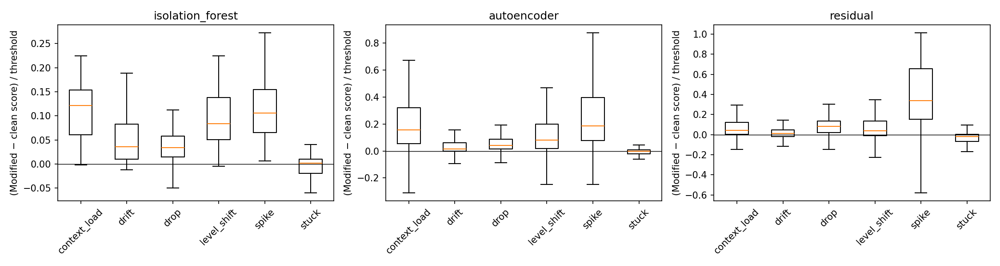
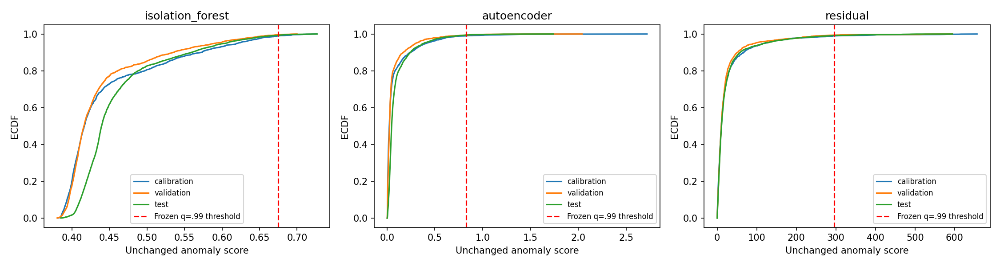
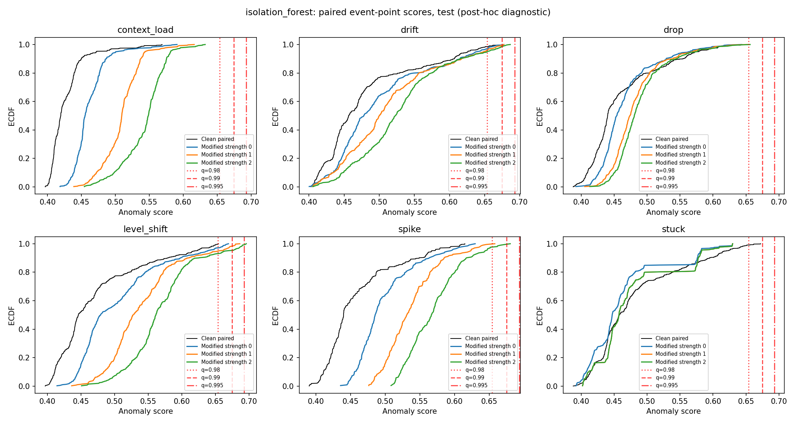
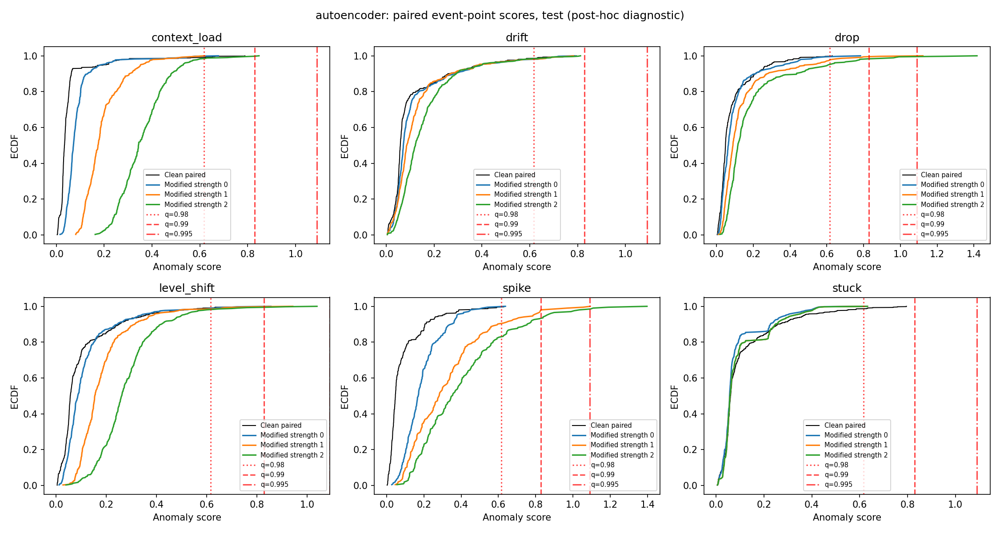
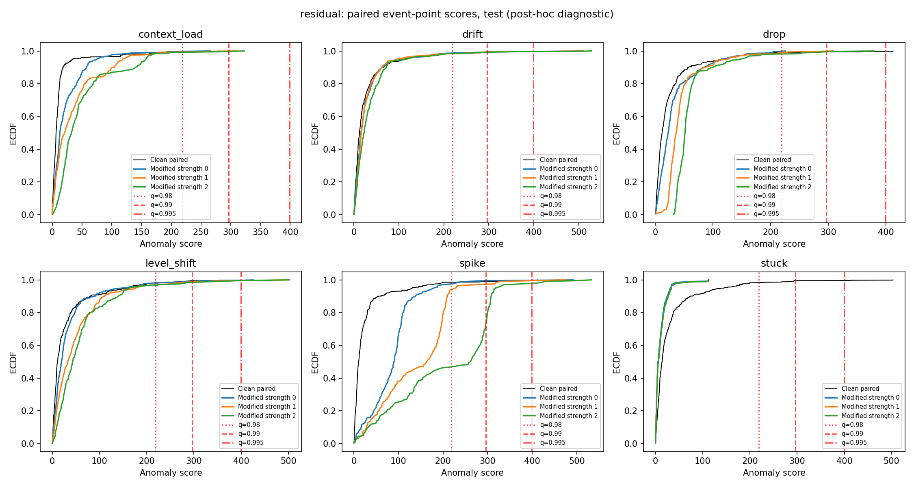

# Stage 4 — діагностичний аудит без зміни експерименту

Аудит виконано після перегляду результатів Stage4. Це **post-hoc діагностика**,
а не новий незалежний експеримент або повторний вибір моделі/порогів.
Базовий коміт: `9d9baab885e563d6912154f3a586cf63712269b2`.
Оригінальні protocol, models, thresholds, scenarios, metrics і selection збережено.

Відтворення: `OMP_NUM_THREADS=1 python -m diagnostics.energy_anomaly_audit`.
Runner лише читає frozen results і створює нову diagnostics директорію;
повторний запуск потребує іншого `--output`. Моделі не завантажує і не навчає.
До/після перевіряє всі407 контрольних сум оригінальних результатів.
[Provenance](diagnostics/provenance.json) фіксує hash скрипту й входів.

## 1. Як порівнювали

Для кожної ін'єкції зіставлено score модифікованого потоку зі score незміненого
потоку **того самого source/event_id/timestamp**. Втручання впливає також на
подальші лаги, rolling statistics, seasonal reference й RF forecast: paired
порівняння охоплює весь цей ефект, а не лише зміну поточного показання.

На test є6,579 labeled event points у95 сценаріях. Це pooled scenario-points:
часові точки/будинок можуть повторюватися в різних сценаріях і не є незалежними
спостереженнями. Значення не замінюють початкові macro metrics за seeds.
Stuck severity0/1/2 не означає різні сили: у вихідному протоколі повторюється
та сама операція. Mixed-події для таблиць за типом розкладено за їх фактичним
типом/силою; це явно відрізняється від оригінального окремого рядка mixed.

Оцінки мають різні шкали: IF — negative score_samples, AE — standardized-feature
MSE, residual — абсолютна помилка Wh. Їхні абсолютні величини між методами
не порівнюємо; межа спрацювання всюди strict score>threshold.

## 2. Оцінки під час ін'єкцій змінюються

Пара test: незмінені й модифіковані значення в тих самих6,579 event points:

| Детектор | Медіана clean score | Медіана modified score | Медіана paired delta | Частка score, що зросли | Нові перетини порога / точки |
|---|---:|---:|---:|---:|---:|
| IF | 0.441259 | 0.494269 | +0.036155 | 87.44% | 37/6579=0.562% |
| AE | 0.052406 | 0.112586 | +0.035559 | 78.04% | 33/6579=0.502% |
| Residual | 10.083695 | 23.502722 | +8.249330Wh | 65.10% | 77/6579=1.170% |

Медіана paired delta не дорівнює різниці двох медіан. «Новий перетин» означає
modified>threshold, clean≤threshold у тій самій точці. Це додаткова діагностична
ознака, а не заміна початкового recall/TP або доказ справжньої фізичної несправності.

Загалом при основному порозі на test event points: IF40 modified перетинів
проти3 clean (37 нових,0 втрачених), AE33 проти3 (33 нових,3 втрачених), residual94
проти30 (77 нових,13 втрачених). Втрачені перетини показують, що втручання
інколи зменшує score, а не лише збільшує його.

Деталі: [paired_overall.csv](diagnostics/paired_overall.csv),
[кожна paired event-точка](diagnostics/paired_event_scores.parquet),
[тип × сила](diagnostics/paired_by_type_strength.csv),
[окремі події](diagnostics/paired_event_summary.csv).

## 3. Калібрування, сила втручань і природна мінливість

Незмінена calibration містить1973 точки. Основні99% пороги і зафіксовані
альтернативи залишилися такими:

| Детектор | q98% | q99% | q99.5% | P99 modified event-score test |
|---|---:|---:|---:|---:|
| IF | 0.653788 | 0.674721 | 0.692888 | 0.665968 |
| AE | 0.616505 | 0.828861 | 1.090165 | 0.742161 |
| Residual | 219.028595Wh | 296.246026Wh | 399.178309Wh | 305.605938Wh |

У IF/AE навіть P99 pooled modified event scores нижчий за основний поріг.
Це підтверджує перекриття розподілів і низьку кількість перетинів у цьому
налаштуванні, але не доводить, що99% був математично неправильним порогом:
він відповідає заздалегідь обраному бюджету calibration alarms.

Train IQR=50Wh. Spike додає100/200/300Wh, level shift/context —50/100/150Wh.
Додавання300Wh не обов'язково означає absolute residual300Wh: впливають
попередня forecast error та наступна реакція прогнозу на змінену історію.

Приклади median paired delta на test за силою0→1→2:

| Тип / детектор | Сила0 | Сила1 | Сила2 |
|---|---:|---:|---:|
| Spike / IF | +0.03846 | +0.07465 | +0.10586 |
| Spike / AE | +0.10429 | +0.20556 | +0.28706 |
| Spike / residual | +75.68Wh | +124.24Wh | +212.71Wh |
| Level shift / IF | +0.03061 | +0.07262 | +0.10832 |
| Level shift / AE | +0.01566 | +0.08247 | +0.19137 |
| Level shift / residual | +4.40Wh | +10.54Wh | +25.87Wh |

У найсильніших spikes частка modified event points вище основного порога:
IF0.493%, AE6.897%, residual27.094%. У найсильнішого level shift — відповідно
4.854%,0.728%,1.699%. Це pooled частки з діагностики, не оригінальні macro recall.
Для stuck median residual delta приблизно−5.9Wh: повтор показання може робити
ряд легше прогнозованим, не створюючи великого residual. В IF/AE зміна score
на stuck мала (приблизно0.001 IF та0.0001–0.0005 AE).

На незмінених calibration даних residual P95=119.84Wh, P99=296.25Wh,
max=656.66Wh; на незміненому test P95=119.21Wh, P99=282.06Wh,
max=594.75Wh. Великі forecast errors існують без синтетичних втручань.
Це емпіричний факт про незмінений ряд; без ground truth не називаємо всі ці
екстремуми гарантовано нормальними або гарантовано аномальними.
IF clean test P99=0.663123 і AE=0.729683 — також нижчі за calibration thresholds.

[Розподіли незмінених вибірок](diagnostics/unchanged_distributions.csv)
та ECDF показують відмінності calibration/validation/test. Пороги за цими
post-hoc графіками не підбирали. Уже зафіксований аналіз98%/99.5% не дає підстав
пояснити всю низьку якість лише одним вибором99%.

## 4. Лагова історія та єдиний mixed test residual hit

Оригінальний hit: `mixed-seed201`, event3, spike strength2,
2016-05-26 14:00–14:10 (naive dataset time), +300Wh на обох інтервалах.

| Час | Actual clean→modified, Wh | Forecast clean→modified, Wh | Score clean→modified, Wh | Modified flag / clean flag |
|---|---:|---:|---:|---|
| 13:50, до події | 70→70 | 97.9822→97.9822 | 27.9822→27.9822 | false / false |
| 14:00 | 80→380 | 79.4321→79.4321 | 0.5679→300.5679 | true / false |
| 14:10 | 70→370 | 88.0167→372.5964 | 18.0167→2.5964 | false / false |
| 14:20, після події | 70→70 | 77.7663→217.1930 | 7.7663→147.1930 | false / false |

Поріг296.2460Wh. У14:00 forecast однаковий: поточне actual ще не потрапило в
його ознаки. Тривоги на clean-потоці в цей момент немає, і alarm episode не
почався до ін'єкції. **Цей конкретний hit не пояснюється pre-existing clean alarm.**

У14:10 forecast delta=284.5797Wh, actual delta=300Wh: зміна історії компенсує
приблизно94.86% додатку в signed residual. Ваги RF не змінюються; реагують його
вхідні лаги/rolling features. У14:20 лишається змінений прогноз попри вже
незмінене поточне actual. [Повна локальна таблиця](diagnostics/sole_residual_hit.csv).

Для441 test-події з тривалістю>1, ненульовим і сталим energy delta перевірено
тотожність `delta_signed_residual = delta_actual − delta_forecast` для кожної
точки. Медіана forecast delta на початку дорівнює0; на кінці подій median
forecast_delta/energy_delta: context0.919, level shift0.810, spike0.894,
drop0.499. Пули відрізняються складом/силою; ці числа не доводять, що конкретна
ознака є єдиною причиною пропуску. [history_response.csv](diagnostics/history_response.csv).

## 5. Подієві метрики: що дозволяє оригінальне правило

Оригінальний matcher бере contiguous alarm episodes і зіставляє кожен з
найранішою ще не зіставленою подією, з якою episode **перекривається**.
**Так, episode може початися до onset і все одно зарахуватися.** First overlap
тоді дорівнює onset, тому записується delay0, хоча нова тривога не виникла.
Одна episode/подія не зараховується повторно; вікно detection точно[start,end].

При основному порозі по всіх сценаріях:

| Split / detector | Оригінально matched events | Episode почалася до події | Clean flag у first overlap | Matched events з хоча б одним new paired crossing |
|---|---:|---:|---:|---:|
| Validation IF | 10 | 6 | 6 | 4 |
| Validation AE | 9 | 6 | 6 | 3 |
| Validation residual | 47 | 0 | 7 | 40 |
| Test IF | 16 | 3 | 3 | 13 |
| Test AE | 28 | 0 | 0 | 28 |
| Test residual | 87 | 0 | 15 | 75 |

У кожному validation-пулі493 події, test962 (повтори сценаріїв не є незалежними
реальними несправностями). Колонки можуть перекриватися: clean flag у first
overlap не виключає нового paired crossing пізніше. Не віднімаємо ці колонки
від оригінальних TP і не перезаписуємо Stage4 metrics. Це контрфактичний опис,
не нова офіційна Precision/Recall таблиця. Зокрема15 clean flags на test residual
не стосуються єдиного mixed hit — той перевірено окремо вище.

[Усі подієві зіставлення](diagnostics/event_overlap_diagnostics.csv) містять
також альтернативні зафіксовані пороги. Нові тести фіксують поведінку при episode
до onset, включному end, alarm лише після end, розриві timestamps і кількох
alarm episodes на одну подію. Production matcher не змінено.

Обмеження методики: довгий episode, що перекриває кілька подій, зараховується
лише одній; це може знижувати event recall, але вимагається протоколом.
Нульова delay умовна на виявлення й може походити з pre-existing episode.
Самі ці обмеження не пояснюють низький point recall, який не залежить від matcher.

## 6. Післяподієві тривоги: що було б без ін'єкцій

Для тих самих tail timestamps (144 інтервали після end, без нових подій)
порівняно clean і modified flags. Суми по test-сценаріях при q99:

| Детектор | Clean tail alarms | Modified tail alarms | Нові paired alarms | Втрачені paired alarms |
|---|---:|---:|---:|---:|
| IF | 577 | 589 | 12 | 0 |
| AE | 604 | 661 | 57 | 0 |
| Residual | 876 | 882 | 24 | 18 |

Отже всі modified tail alarms не можна приписати втручанню: значна частина
існувала й у clean-потоці. Paired відмінність ізольовано показує ефект
зміненого входу за фіксованої моделі в цьому replay, але не встановлює
причини природних clean alarms. Суми включають повторні сценарії;
це не кількість унікальних операційних тривог. [paired_recovery.csv](diagnostics/paired_recovery.csv).

## 7. Висновки та гіпотези

**Підтверджено даними/кодом:** scores реагують на ін'єкції; більшість реакцій
залишається нижче порогів; природні forecast errors перекривають силу багатьох
втручань; RF-входи швидко змінюються після події, зменшуючи residual навіть
за сталого додатку; частина оригінальних event hits може збігатися з clean
alarms або pre-existing episodes. Єдиний mixed residual hit є новим threshold
crossing у paired порівнянні. Оригінальні вибір/метрики залишаються чинними
результатами свого протоколу з цими додатково поясненими обмеженнями.

**Гіпотези для окремого майбутнього протоколу:** контекстні пороги за режимом
навантаження, ознаки тривалості/зависання й детектори змін можуть покращити
якість. Цей аудит не виконував ablation ознак, перепідбір thresholds,
перенавчання чи перевірку нової моделі на незалежних даних. Тому не встановлює
причинність конкретної ознаки і не гарантує, що запропоновані зміни допоможуть.

Поточні IF/AE/residual залишаються **experimental**. Жоден не рекомендується
як готове операційне визначення несправностей; Stage5 має показувати саме scores,
пороги, status і епізоди їх перевищення з відповідним позначенням.

## Перевірки та незмінність

Додано5 граничних unit-тестів. Повторний повний запуск: **47 тестів пройдено**
(44 unit,3 Kafka integration). [Preservation check](diagnostics/preservation.json)
підтверджує незмінний hash реального model bundle,12 hashes вихідного anomaly-коду
та відсутність diff у захищених оригінальних шляхах. Наявні protocol/results
не перегенеровувалися. Stage5 — лише [окремий план](../stage5-integration-plan.md),
без реалізації сервісів. PR цього доопрацювання має залишатися відкритим до
окремого підтвердження злиття.

## Графіки

