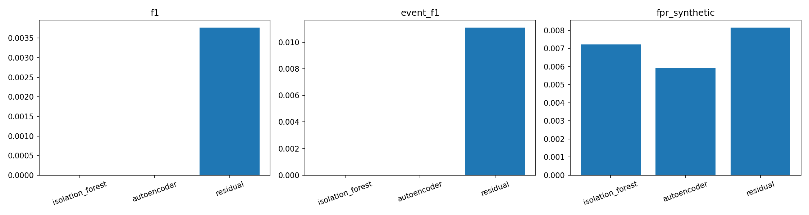
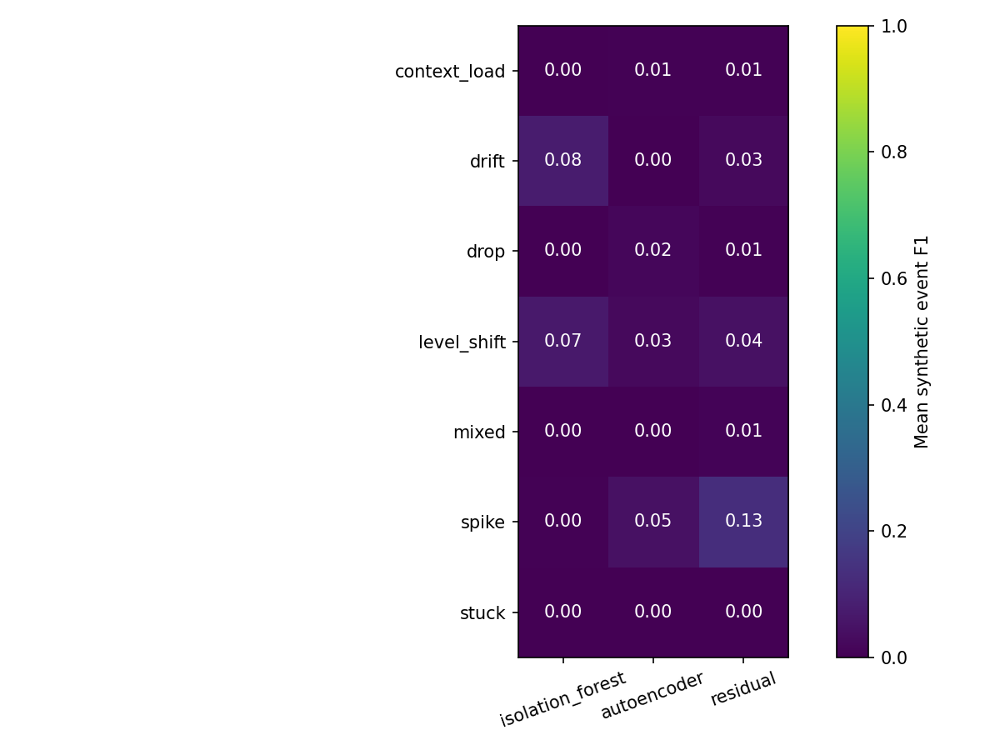
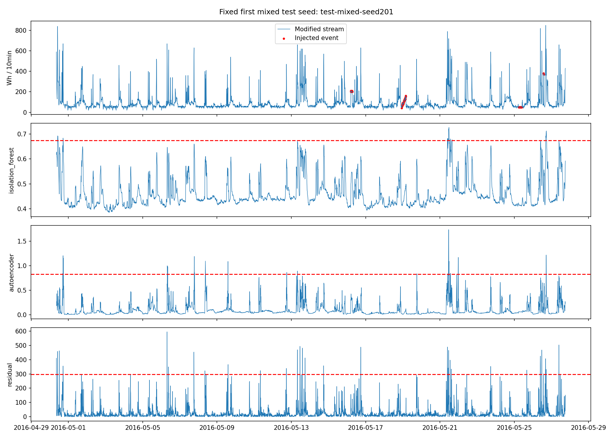
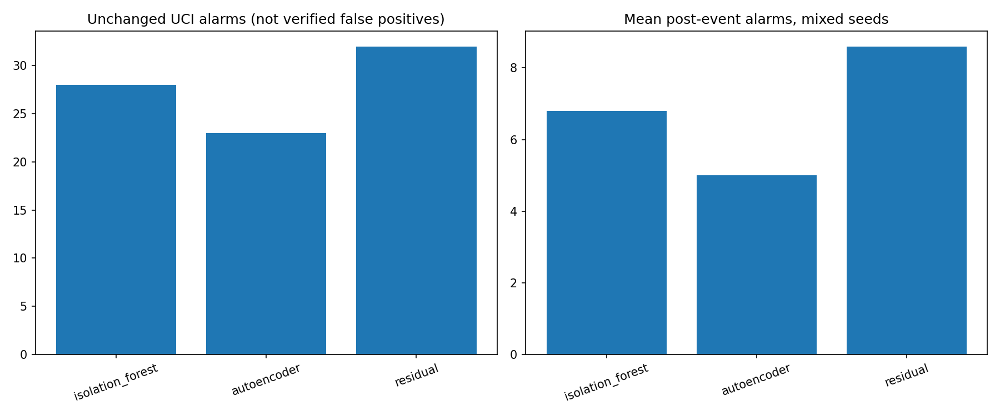

# Stage 4 — Energy Anomaly Detection

Frozen protocol: [protocol.md](../protocol.md). All thresholds/models/scenarios were fixed before test evaluation.

**This is a synthetic-intervention benchmark on an already-viewed UCI series, not an unseen holdout or verified real fault dataset.**

Validation-selected detector: **residual**. Selection is saved in selection.json before test scoring. No test-based switch is made.

## Test mixed scenarios, primary 99th-percentile thresholds

Metrics below are macro means over five seeds; the actual injection prevalence is recorded in injections.csv. Synthetic FPR/precision assume the unlabeled background is negative.

| Detector | Precision | Recall | F1 | Synthetic FPR | Event F1 | Alarms/day | Mean matched-event median delay (min) |
|---|---:|---:|---:|---:|---:|---:|---:|
| isolation_forest | 0.0000 | 0.0000 | 0.0000 | 0.0072 | 0.0000 | 1.02 | undefined |
| autoencoder | 0.0000 | 0.0000 | 0.0000 | 0.0059 | 0.0000 | 0.84 | undefined |
| residual | 0.0061 | 0.0027 | 0.0038 | 0.0082 | 0.0111 | 1.16 | 0.00 |

## Unchanged test control

These alarms are not confirmed false positives. Original UCI data have no trustworthy anomaly labels.

| Detector | Alarms | Alarm rate | Alarms/day |
|---|---:|---:|---:|
| isolation_forest | 28 | 0.7096% | 1.02 |
| autoencoder | 23 | 0.5829% | 0.84 |
| residual | 32 | 0.8109% | 1.17 |

## Readiness, events and recovery

- isolation_forest: partition coverage 100.00%; full replay unready rows 6 including 144 context records.
- autoencoder: partition coverage 100.00%; full replay unready rows 6 including 144 context records.
- residual: partition coverage 100.00%; full replay unready rows 144 including 144 context records.

Detection window is strictly event start through end; contiguous alarm episodes are matched one-to-one, without point adjustment. Missed events remain missed and have no artificial zero delay. event_outcomes.csv preserves individual detections/delays. Post-event tail is 144 intervals; its alarms remain included in background errors.

| Detector | Mean alarms during events | Mean post-event alarms | Mean missed fraction |
|---|---:|---:|---:|
| isolation_forest | 0.00 | 6.80 | 1.0000 |
| autoencoder | 0.00 | 5.00 | 1.0000 |
| residual | 0.20 | 8.60 | 0.9500 |

## Figures

## Artifacts and limits

by_type.csv and by_severity.csv stratify all types/strengths and all three thresholds. metrics.csv preserves each scenario/seed; no favorable seed is selected. scores/ stores every score, forecast, actual and intervention label; manifests/ records exact original/modified values and placement. thresholds.json, model_metadata.json, metadata.json and checksums.json record provenance.

IF/AE use the shared 20-feature contract; the dedicated residual RF uses the unchanged 21-feature contract and prior-interval predictions. RF is newly fitted on Stage 4 train only, but its hyperparameters were historically selected using Stage 3 validation. That prior exposure cannot be undone. No model fits calibration, validation or test during Stage 4.

High loads are not automatically anomalies. Synthetic faults do not establish operational precision. Large amplitudes can be easier than realistic faults; slow drift or stuck readings can become part of history and cease triggering residuals. Repeated seeds share the same household and timeline and are not independent households. Production Energy forecasting, IoT and Stage 2/3 results remain unchanged.
