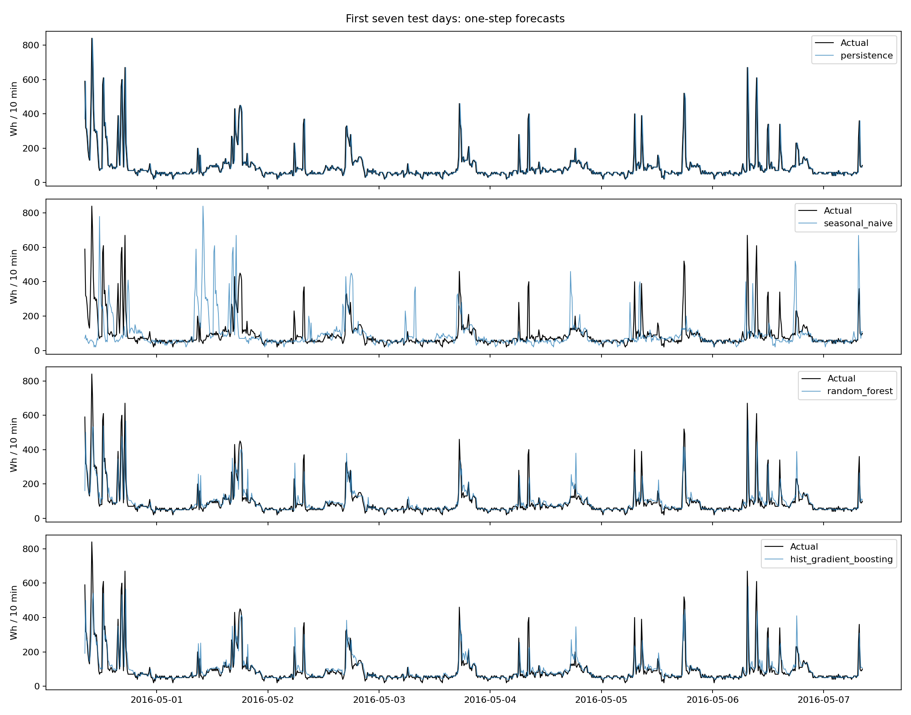
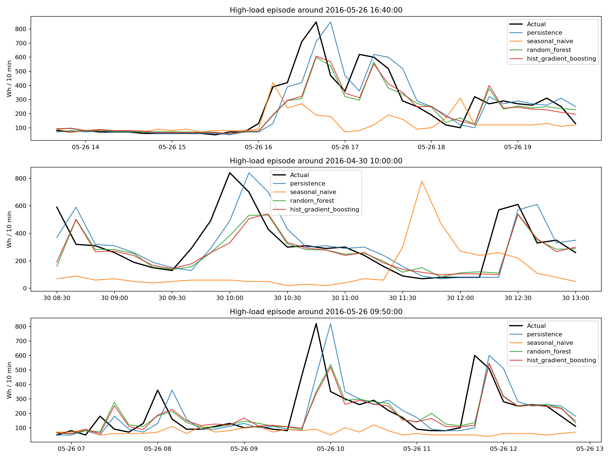
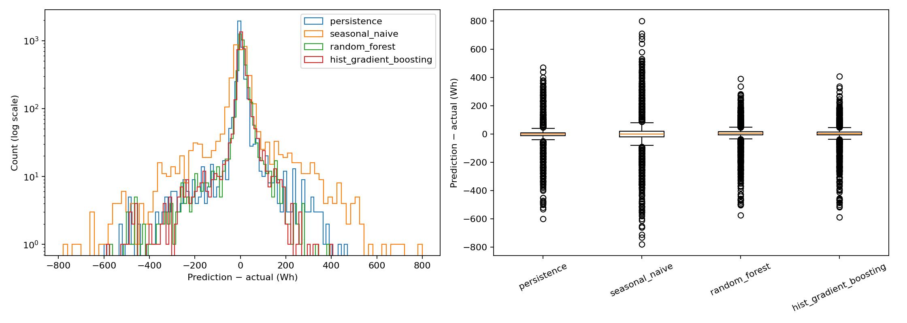
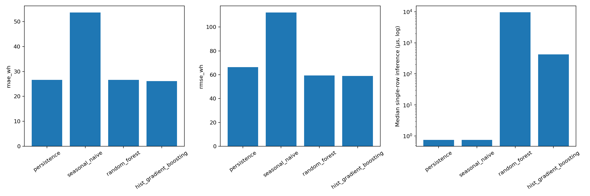

# Stage 3 — Forecasting Model Benchmark

Protocol: [frozen protocol](../protocol.md), SHA-256 `1e9758a7a1b916f4e676739313b24bb107deb2bea15a5fcece2933bac55faf02`.
Implementation commit: `0f7776ce3c20f2c08010864ebae00848e6bd32c2`. Seed: 42.
Dataset SHA-256: `2820bf712ad0275cb18b85a05250926100d8e65ebb9f4d2d016ca91ea152a25d`. Target: appliances energy in Wh per 10-minute interval.
Original timezone-naive timestamps are preserved. Horizon: 10 minutes.

## Evaluation protocol

**The test window was already inspected in Stage 2. It is not an unseen independent holdout.**
Model/hyperparameter choices use validation MAE, then RMSE only. Test results are descriptive confirmation, not a selection criterion.
Each test forecast uses observations available at its origin, including earlier observed test values; this is rolling one-step evaluation, not a multi-step forecast from one fixed origin.
All four models use the same target rows; 144 uninterrupted historical measurements are required.
Seasonal Naive uses exactly target time minus 24 hours. Both ML models use the same 21 causal features and median imputation fitted on train during selection, then train+validation during final refit.

Splits (target timestamps):

- train: 11699 targets, 2016-01-12T17:00:00 through 2016-04-02T22:40:00.
- validation: 3946 targets, 2016-04-02T22:50:00 through 2016-04-30T08:20:00.
- test: 3946 targets, 2016-04-30T08:30:00 through 2016-05-27T18:00:00.

## Validation selection

| Model | MAE (Wh) | RMSE (Wh) | MAE improvement vs persistence | Median inference (µs) |
|---|---:|---:|---:|---:|
| persistence | 28.4415 | 71.9733 | — | — |
| seasonal_naive | 60.2560 | 127.3745 | — | — |
| random_forest | 26.4435 | 61.2366 | — | — |
| hist_gradient_boosting | 26.5449 | 60.9925 | — | — |

Recommended by validation: **random_forest**. This decision was saved before test evaluation.

Selected parameters (RF also random_state=42, n_jobs=1; HGB also random_state=42, early_stopping=False, loss=squared_error):

- random_forest: `{"max_depth": 12, "min_samples_leaf": 10, "n_estimators": 400}`.
- hist_gradient_boosting: `{"l2_regularization": 0.0, "learning_rate": 0.05, "max_iter": 100, "max_leaf_nodes": 15}`.

## Common test observations

| Model | MAE (Wh) | RMSE (Wh) | MAE improvement vs persistence | Median inference (µs) |
|---|---:|---:|---:|---:|
| persistence | 26.6396 | 66.4367 | 0.00% | 0.75 |
| seasonal_naive | 53.6239 | 112.1090 | -101.29% | 0.75 |
| random_forest | 26.6304 | 59.3745 | 0.03% | 9618.44 |
| hist_gradient_boosting | 26.1325 | 58.9202 | 1.90% | 422.79 |

Positive improvement means lower error than persistence; negative means worse. RMSE improvements are included in metrics.csv.

## High-load observations

Threshold: actual > **210.0000 Wh**, the train-only 90th percentile (linear interpolation). Count: **312**. High loads are not automatically anomalies.

| Model | MAE (Wh) | RMSE (Wh) | MAE improvement vs persistence | Median inference (µs) |
|---|---:|---:|---:|---:|
| persistence | 150.2885 | 199.2237 | 0.00% | — |
| seasonal_naive | 250.5128 | 288.8705 | -66.69% | — |
| random_forest | 127.3175 | 176.8125 | 15.28% | — |
| hist_gradient_boosting | 126.2827 | 175.8250 | 15.97% | — |

Signed errors are prediction minus actual; negative values indicate underprediction.

| Model | Mean signed error (Wh) | Underprediction fraction |
|---|---:|---:|
| persistence | -59.4551 | 57.69% |
| seasonal_naive | -211.2179 | 87.18% |
| random_forest | -89.5908 | 67.95% |
| hist_gradient_boosting | -91.7849 | 71.47% |

## Figures

## Reproducibility and limitations

All test predictions are in `test_predictions.csv`; every split membership is in `split_membership.csv`.
`selection.json`, `validation_trials.json`, `protocol.json`, and `metadata.json` record choices, all candidates, checksums, features, versions and runtime environment. Models are stored separately under ignored artifacts/; their hashes are recorded.
Inference timing includes imputation and a single-row predict call, excludes feature construction, storage and loading; 256 evenly spaced test rows, five passes after ten warmup calls, one thread. Raw timings and p95 are saved. Timing varies across hardware/runs and does not determine the winner.
This is a single household, a single chronological split, and an already-viewed test window. It is not evidence of generalization to arbitrary buildings. No statistical significance claim is made.
The Stage 2 metric comparison is not controlled: Stage 3 adds a daily feature and a longer shared warmup. Production Kafka inference remains unchanged. Integration of any selected model is a separate task.
