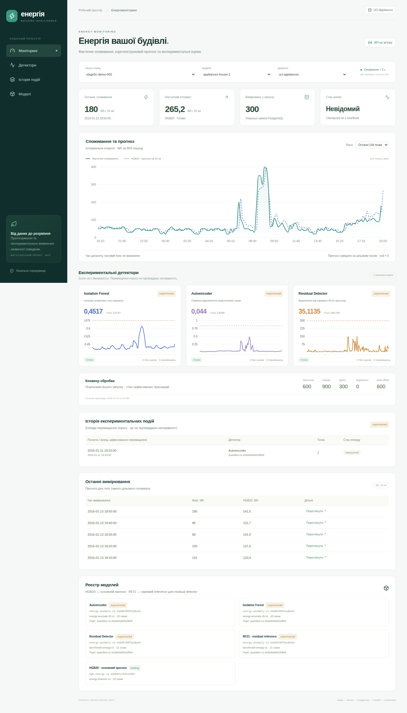
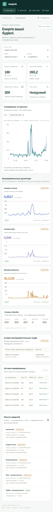

# Stage 5C — Web Dashboard & Docker Integration

## Реалізований MVP

React19 + TypeScript7 + Vite8 + Recharts3; усі npm versions зафіксовані разом із
lockfile. Український responsive Dashboard: run/building/source, обмежене видиме
вікно72/144/288 точок, графік фактичних Wh і HGB20, окремі IF/AE/residual panels
з власними шкалами/threshold, історія experimental episodes, registry версій,
лічильники PostgreSQL/checkpoint і деталі часових міток. Світлий інтерфейс із
темною навігацією, desktop і mobile layouts; жодних зовнішніх шрифтів/CDN.

### Запуск із чистого clone

Потрібні Docker із Compose та Python3.10+ для CLI. Host Python не потребує
ML-бібліотек; runtime використовує Python3.13 у контейнері. Host Node не потрібний.
Усі команди виконуються з кореня repo.

```bash
python3 -m integration.demo prepare
python3 -m integration.demo up
# Відкрити http://127.0.0.1:8088
python3 -m integration.demo replay --limit 300 --sleep 0.15
```

Prepare виконує build, створює приватний ignored `.env.mvp`0600 без друку
пароля, завантажує UCI CSV (лише якщо його немає), готує моделі в новому ignored
`artifacts/mvp/docker/` за frozen Stage2/4 configs. Це provisioning, не новий
порівняльний експеримент; старі артефакти/протоколи/метрики не перезаписуються.
CSV checksum і train-only/calibration правила перевіряє наявний5A preparer.
Чистий CPU fit може тривати кілька хвилин. Дані та original artifacts не входять
у Docker build context або Git. Runtime worker монтує artifacts read-only.

Якщо є trusted локальні артефакти, перший prepare може зареєструвати їх без fit:

```bash
python3 -m integration.demo prepare \
  --hgb artifacts/energy/appliances-hgb-bound-v1/model.joblib \
  --anomaly artifacts/energy-anomaly/v1/bundle.joblib
```

Manifest контейнерного середовища окремий від host manifest: точна версія
CPU torch може мати suffix `+cpu`. Шляхи manifest відносні, libraries/hashes
перевіряються до роботи. Для іншої нової директорії:
`export MVP_DOCKER_ARTIFACT_MANIFEST=artifacts/mvp/docker-v2/manifest.json`.
Для tools із числовим UID host/CI, якого немає в container passwd, USER і
Torch cache directories визначені явно у writable /tmp. Це усуває помилку
getpass під час чистого deterministic AE provisioning без зміни fit/config.
Наявний output не перезаписується. Після частково невдалого provisioning
виберіть нову ignored директорію; не видаляйте original experiments.
Не підключайте joblib/pickle з недовірених джерел.

`up` перевіряє наявність manifest, автоматично застосовує Alembic, створює
порожній single-partition topic, перевіряє моделі й запускає worker до replay.
У порожньому Dashboard є пояснення очікування producer. Міграції виконуються
окремим одноразовим сервісом, не FastAPI чи worker.

```bash
python3 -m integration.demo restart  # worker + nginx/Dashboard
python3 -m integration.demo status
python3 -m integration.demo logs
python3 -m integration.demo stop     # зберігає named volumes
```

Повторний replay тих самихevent IDs у тому самому run — перевірка duplicates,
а не нові вимірювання. Для нового replay задайте **разом** у тому самому shell:

```bash
export MVP_RUN_ID=defense-002
export MVP_GROUP_ID=defense-002
export MVP_TOPIC=defense-002
python3 -m integration.demo up
python3 -m integration.demo replay --limit 300 --sleep 0.15
```

MVP_WEB_PORT змінює лише localhost порт, MVP_COMPOSE_PROJECT — окремий набір
контейнерів/volumes. Для restart і наступного replay залишайте той самий context.
Не запускайте одночасно два workers для одного run/group. Зупинка Docker не
видаляє PostgreSQL/Kafka volumes. `.env.mvp` існуючого host5A не перезаписується.

## Архітектура та локальна безпека

```text
127.0.0.1:8088 → nginx / React
                  └─ /api → 127.0.0.1:8000 FastAPI → PostgreSQL
                              ↑ спільний namespace, не відкритий API bind
Kafka:29092 → окремий worker → PostgreSQL:5432
                   └─ trusted artifacts (read-only)
```

Новий `docker/docker-compose.dashboard.yml` — окремий project `energy-dashboard`.
Старі legacy та5A Compose не змінені. Backend network позначена internal;
postgres/kafka/worker не публікують host ports. API і nginx ділять namespace
через `network_mode: service:api`. API **залишається на127.0.0.1:8000** із
незміненим local-only middleware та disabled proxy headers. nginx передає
запити на loopback; немає allow-all middleware, trusted-forwarded IP обходу
або опублікованого8000-порту. Лише namespace proxy/API також має окрему edge
bridge для localhost port forwarding. Ця мережа не робить8000 доступним іншим
контейнерам: там немає non-loopback listener.

Єдина host publication — `127.0.0.1:8088:8080`. Internal Kafka advertised listener
`kafka:29092`, DB URL у runtime посилається на `postgres:5432`. Host localhost
адреси5A не переносяться всередину контейнерів. Provisioning tools мають окрему
egress network для завантаження CSV; runtime worker її не має. Це **локальний**
MVP без remote authentication. Не відкривати порти в LAN і не додавати
public reverse proxy/tunnel без окремої автентифікації.

nginx same-origin proxy: GET-only API, no-store, gzip, CSP, no remote assets.
Vite dev proxy використовує host API127.0.0.1:8000; CORS5B не розширено.
Backend images запускаються non-root; trusted artifacts лише read-only в
worker/bootstrap, в API їх не монтуємо. Dockerignore виключає `.env*`, data,
artifacts, `.git`, node_modules. Python/Node/nginx/browser base images pinned
за digest; runtime Python/npm versions pinned. Build-time Docker доступ не є
частиною production container. Browser test image із Docker socket призначений
лише для локальних/CI тестів; не запускати його як публічний сервіс.

Перевірка фактичного networking:

```bash
python3 -m integration.security_check
```

Вона перевіряє127.0.0.1 host bindings, відсутність DB/Kafka ports і невдале
TCP-з'єднання worker→api:8000; звичайний browser→nginx→API відповідає200.
Якщо API container перестворюється, потрібно перестворити nginx namespace
через той самий `demo up`; Compose залежність містить restart propagation.
Звичайний `demo restart` перезапускає worker/Dashboard без перестворення API.

## Контракти Dashboard

- Основний графік використовує **лише** `purpose=primary_forecast` (HGB20).
  Join за forecast_target_timestamp, не за origin/received_at. RF21 показано
  в registry як окремий residual reference; його прогнозна лінія не підміняє HGB.
- Для dataset_naive ніколи не викликаємо Date/Date.parse із label. Сортування
  за ISO labels, форматування рядка без конвертації. Підпис:
  **«Час датасету, часовий пояс не визначено»**. Для offset_aware допускається
  абсолютне порівняння за явним offset, підпис зберігає початковий час джерела.
- Default — останні144 вимірювання вибраного replay, не календарний today.
  Вікна позначені кількістю точок, не удаваним безперервним часовим діапазоном.
  Деталі показують measurement timestamp, forecast origin/target, generated_at
  та received_at окремо. Системні timestamps явно UTC.
- Wh — інтервальна енергія (Appliances600с), не W. У фактах показуємо збережену
  тривалість інтервалу. Forecast — наступні600с. null не стає0/false; лінії не
  з'єднують null-прогнози, warm-up та incompatible пояснені текстом.
- IF/AE/residual мають окремі шкали score/threshold, maturity **experimental**.
  Score — не probability, episode — не встановлена несправність. Відсутні
  scores/warm-up видимі окремо від нормального flag=false. Registry зберігає
  model/feature/threshold versions. Жодного перенавчання/inference у frontend/API.
- Polling через2с **після завершення** попереднього cycle; max864 scores,
  289 primary forecasts,288 measurements,50 events. Metadata теж bounded.
  Це контрольоване оновлення видимого вікна, не повторне читання19735 рядків.
  На failure backoff4/8/16/30с, на success знов2с. Cycle timeout12с;
  AbortController/timers очищаються при зміні вибору та unmount. Late responses
  старого run не замінюють поточні дані. На збій показуємо повідомлення й stale
  snapshot, після recovery нові дані приходять без reload.
- Pipeline counters scoped **цілим run**, charts/events — selected source.
  Додано тільки2 read-only counters до5B pipeline status: forecasts/anomaly_scores.
  Checkpoint/recovery/write transactions і DB schema не змінені.
  `worker_status=unknown` збережено; `API на зв’язку` не означає живий worker.

## Перевірки

Локально пройшло **87 Python tests**:58 unit,3 Kafka smoke,12 PostgreSQL/Kafka
recovery,14 PostgreSQL API;0 failures/0 skips (62.804с).
Frontend: **8 unit tests**, TypeScript check та production build успішні.
Browser contracts: timezone `Pacific/Honolulu`, naive label без shift,
target alignment, null/warm-up/incompatible, run/source switch, experimental
labels, API503/recovery без reload, bounded primary-only requests.

Справжній Docker browser E2E стартує з0 rows, запускає300 readings через Kafka,
бачить проміжне зростання кількості в DOM, перезапускає worker+Dashboard під
час replay, отримує300/600/900, перевіряє persisted forecast values/generated_at,
HGB20/RF21 registry, наявну experimental episode і відсутність browser errors.
Потім повторно доставляє ті самі300 readings: duplicates300, next_offset600,
кількість measurements300/forecasts600/scores900 незмінна. Другий restart і
reload зберігає результати та144 points у видимому вікні. Це новий run, без
змін архівних Stage2/3/4 datasets/results.

[Фактичні числа E2E](5c-e2e.json) містять run_id, проміжний count, число
перевірених незмінних forecasts та browser errors. Подія з original stream
залишається експериментальним перевищенням, не підтвердженою аномалією.

```bash
# Попередні тести: host .venv + окремі реальні5A PostgreSQL/Kafka
OMP_NUM_THREADS=1 python tests/run_suite.py --suite all
# Frontend (необов'язковий host Node22.12+)
cd dashboard
npm ci
npm test
npm run typecheck
npm run build
cd ..
# Browser contracts: ізольований Linux Chromium, не потребує моделей/API
python3 -m integration.browser_tests
# На НОВОМУ порожньому run повного Docker MVP
python3 -m integration.browser_tests --live --capture
```

На Docker Desktop/macOS для останньої команди задайте
`MVP_DOCKER_SOCKET=$HOME/.docker/run/docker.sock`, якщо socket не доступний як
`/var/run/docker.sock`. Linux/CI використовує default. Browser test runner
монтує repo за тим самим абсолютним шляхом, що на host, і використовує окремий
anonymous node_modules volume; host native npm packages не перезаписуються.
Скриншоти з реального replay, не макети:





CI додано2 jobs: frontend unit/typecheck/build/browser contracts та повний
Docker clean-clone provisioning →300 Kafka readings→live browser/restart/duplicates.
Попередні4 Python/Kafka/PostgreSQL/API jobs збережено.

## Файли та обмеження

Нові `dashboard/`, backend/dashboard/e2e Dockerfiles, nginx config, окремий full
Compose, `integration/{demo,stack_bootstrap,browser_tests,security_check}.py`,
unit setup tests, цей звіт/screenshots/E2E JSON. Оновлено README/CI/ignore та
додано2 read-only поля pipeline status. Worker та оригінальні експерименти не
змінені. Credentials, datasets, manifests і моделі не в Git.

Обмеження: без auth/heartbeat/remote deployment; одиночний worker/partition і
чинні5A recovery invariants. UI показує останні50 events та до1000 metadata
entries; повна історія доступна через cursor API. Перезапуск producer починає
CSV спочатку й демонструє duplicates; новий replay потребує нового run context.
HTTP endpoints не є спільним snapshot: при активному replay лічильники та
окремі series можуть коротко відрізнятися на кілька записів до наступного poll.
Graphs — окремі спостереження із label timestamps; не виконуємо gap imputation.
Production JS bundle ≈614KB/183KB gzip, основна частина — Recharts; для локального
MVP це прийнятно, lazy loading можна зробити окремо. Дані залишаються між stop/up;
очищення Docker volumes навмисно не приховане за звичайним stop.

Документація компонентів:
[Docker network_mode](https://docs.docker.com/reference/compose-file/services/#network_mode),
[Vite setup](https://vite.dev/guide/),
[Playwright web server](https://playwright.dev/docs/test-webserver).
