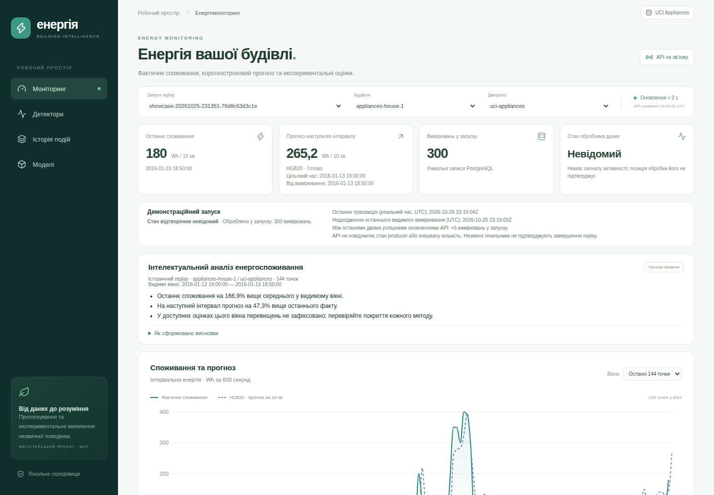

# Stage 7A.1 — Dashboard UX та пояснення енергоспоживання

База: `main` після Stage 7A, `b55601f1739c7e51519db9db9d3c504466bda667`. Гілка: `feature/dashboard-ux-insights`.

## Що змінено

Після KPI та перед графіком додано «Інтелектуальний аналіз енергоспоживання»: три короткі підсумки та розгортані пояснення розрахунків. Це детермінований presentation layer, без LLM, нової ML-моделі або голосування детекторів.

Картка HGB20 показує цільовий час і час вихідного вимірювання. Таблиця містить прогноз для часу факту в рядку; верхня картка — для наступного інтервалу. Різниця цих чисел очікувана. RF21 залишається reference для residual detector.

Картки детекторів явно рахують перевищення у видимому вікні. Історія епізодів — останні 50 за весь вибраний run/building/source, з повідомленням про наявність наступної сторінки. Один епізод і кілька перевищень у точках — різні показники. Лічильник прогнозів запуску включає HGB20 + RF21, лічильник оцінок — три методи; записи warm-up також входять до цих DB-лічильників.

На осі головного графіка є день і місяць разом із часом, у tooltip — повна дата. Осі score мають власні шкали, ширший лівий відступ і компактні числові підписи. Уточнено терміни та трохи ущільнено верх сторінки без зміни структури чи стилю.

## Джерела даних і правила

Використано ті самі read-only endpoints: measurements, primary forecasts, anomaly scores, events, pipeline-status. Нових API-запитів і backend-змін немає. Видиме вікно — останні 72/144/288 фактичних вимірювань обраного джерела; до 3 scores на точку. Insights не використовують історію епізодів як заміну scores поточного вікна.

1. Середнє — арифметичне середнє скінченних невід'ємних Wh із тим самим додатним interval_seconds, що в останнього вимірювання. У деталях показано кількість використаних точок. Остання точка входить до середнього; це описове порівняння, не оцінка норми. Для відносного відхилення потрібно щонайменше дві коректні точки і середнє > 0: `(останнє − середнє) / середнє × 100%`.
2. Коротка динаміка — середнє останніх трьох проти попередніх трьох. Потрібні 6 послідовних точок із однаковими інтервалами, без пропусків. Нульовий знаменник не дає визначеного відсотка. Довгострокової тенденції з цього не виводимо.
3. Наступний HGB20 прогноз має `purpose=primary_forecast`, measurement_id останнього факту, origin того самого моменту та target рівно через 600 секунд. Порівняння прогнозу з останнім фактом має ту саму формулу; нульовий факт не дає визначеного відсотка. Старий прогноз і RF21 не підміняють відсутній наступний прогноз. Значення ready повинно бути скінченним і невід'ємним.
4. Кожний детектор розглядається незалежно. Перевірені точки мають `status=ready`, скінченні score/threshold і boolean flag. Рахуються збережені flags, пороги не перекалібровуються. Покриття — число перевірених вимірювань цього методу / число вимірювань вікна. За неповного покриття фраза про відсутність перевищень стосується тільки доступних оцінок. Scores не є ймовірностями, перевищення не є підтвердженою несправністю.
5. Відсотки округлюються до одного десяткового знака; зміни менші за 0,05% описано як «практично на рівні», відповідно до точності відображення. Wh — інтервальна енергія, не W. Для UCI інтервал становить 600 секунд.

Модуль правил: `dashboard/src/insights.ts`; відображення: `InsightsPanel.tsx`. Три підсумки відокремлено від пояснень кожного методу, щоб майбутню інтерпретацію можна було додати явно, без прихованого комбінованого detector.

## Відсутні дані та час

Порожня історія, некоректні числа, warm-up, gap та incompatible мають окремі пояснення. Null/NaN/Infinity не відображаються як нуль. Відсутність оцінок не описується як відсутність аномалій. Прогноз подано як оцінку, а не гарантовану подію.

`dataset_naive` зберігається як календарний текст; його не передаємо в Date/Date.parse, не призначаємо UTC і не конвертуємо через timezone браузера. Для перевірки 600-секундного горизонту й безперервності використано арифметику календарних компонентів з урахуванням високосних років. Offset-aware instants порівнюються за явними offsets. Повні UTC processing timestamps окремо підписані й не підміняють час вимірювання UCI 2016 року.

## Replay та оновлення

Поточний API не має достовірного lifecycle producer або очікуваної кількості повідомлень, тому показуємо «Стан відтворення невідомий». Не виводимо «виконується», «завершено», «перервано» або знаменник 300 зі стабільного лічильника чи checkpoint. Нову систему керування процесами не додано.

Показуємо підтверджений run-wide count, UTC час останньої транзакції, надходження останнього видимого вимірювання і приріст run-wide count між двома успішними polling-циклами. Це спостереження надходжень, не heartbeat. Worker status залишається unknown. Окремо видно доступність API; при втраті зв'язку висновки позначені як останні отримані дані.

Використано чинний polling ≈ 2 с, backoff до 30 с, abort/timeout і захист від паралельних циклів. Insights перераховуються з нового Snapshot; run/building/source/window скидають попередній Snapshot і порівняння лічильників. Немає додаткових таймерів, запитів, WebSockets або анімацій.

## Перевірка через showcase

З кореня підготовленого clone:

```bash
python3 -m integration.demo showcase
```

Відкрити URL із виводу команди. Спостерігати зростання кількості вимірювань і зміну Insights без перезавантаження. Розгорнути «Як сформовано висновки», порівняти HGB20 target із верхньою карткою та таблицею. Перемкнути вікно 72/144/288 і за наявності інший запуск/джерело. Навіть після завершення команди Dashboard чесно залишає lifecycle replay невідомим, доки read-only API не має достовірного контракту такого стану.

Чинні моделі, артефакти, thresholds, Kafka messages, DB checkpoint/recovery і поведінку showcase не змінено. Stage 2–6 та їхні результати не зачіпалися.

## Перевірки та обмеження

Локально: 23 frontend unit tests, TypeScript і production build успішні; 72 попередні Python unit tests успішні. Vite повідомляє наявне попередження про bundle >500 kB; build успішний. Локальні browser/Docker перевірки тут недоступні: sandbox забороняє bind порту Vite (`EPERM`) і доступ до Docker socket. Це не результат реального replay.

Browser contracts перевіряють часові підписи в timezone Pacific/Honolulu, origin/target, різницю з табличним прогнозом, перемикання run/building/source/window, null/warm-up, область лічильників та mobile overflow. Повний GitHub Actions E2E порівнює текст Insights із реальними відповідями API після кожного з двох незалежних showcase, зберігає desktop/mobile screenshots і перевіряє збереження моделей та результатів після restart.

## Фактичний результат CI та реальний вигляд

Код `2a24af4478b0c6aa642743d8a16cf4eb8bd7527d` пройшов усі шість завдань [GitHub Actions](https://github.com/Axmetik/Pipeline_Kafka_AI/actions/runs/40243071339): 72 Python unit tests, 3 Kafka smoke tests, 12 PostgreSQL/recovery tests, 14 API/PostgreSQL tests, 23 frontend unit tests, TypeScript, production build, 2 browser contract tests, live/recovery E2E та два реальні showcase. Попередній збій нового browser contract test був пов'язаний із селектором: Recharts рендерить текст осей в окремому SVG label layer. Селектор виправлено, перевірку переходу через північ збережено.

| Перевірка | Showcase 1 | Showcase 2 |
|---|---:|---:|
| Нові вимірювання, помічені під час replay | 11 | 18 |
| Фінальні measurements | 300 | 300 |
| Forecast records (HGB20 + RF21) | 600 | 600 |
| Score records (IF + AE + residual) | 900 | 900 |
| Duplicates / rejected | 0 / 0 | 0 / 0 |
| Наступний offset | 300 | 300 |
| Збережені незмінними прогнози після restart | 600 | 600 |

Це функціональні перевірки демонстрації, не performance benchmark. Для обох запусків підтверджено автоматичний вибір run, оновлення без перезавантаження, відповідність усіх пояснень API-даним, незмінність контрольних сум моделей; browser errors — 0. Desktop/mobile screenshots і JSON збережено в [артефакті showcase-verification](https://github.com/Axmetik/Pipeline_Kafka_AI/actions/runs/40243071339/artifacts/12617907637). Компактні підтвердження: [verification.json](verification.json). Метрики попередніх ML-експериментів не змінювались.

Нижче — реальний знімок CI після другого replay (`showcase-20261025-231351-76d8c63d3c1e`), а не mock. Останній факт — 180 Wh, HGB20 прогноз — 265,2 Wh із target 2016-01-13 19:00:00. Висновок «166,9% вище середнього» стосується останніх 144 точок, а не норми енерговикористання. Підставні дані browser contract tests не використовувалися для цього знімка або чисел.



Повнорозмірні PNG `dashboard.png`, `dashboard-top.png` і `dashboard-mobile.png` доступні в артефакті. Компактний JPEG у Git експортовано з того самого реального браузерного сеансу. Подальший коміт документації та знімка не змінює перевірену логіку UI; актуальний CI фінального head видно у [PR #6](https://github.com/Axmetik/Pipeline_Kafka_AI/pull/6).

Обмеження: описове середнє не є енергетичним нормативом; коротка динаміка не доводить причин чи довгострокових змін. Інтерфейс не встановлює несправності. Зведення обмежене завантаженим вікном; polling може пропускати проміжні стани швидкого replay. Production SLA та роботу з фізичними smart meters цими UX-перевірками не встановлено.
