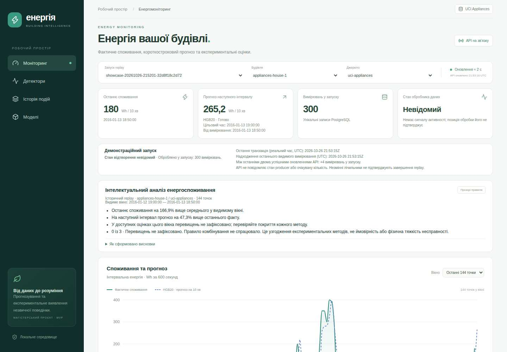

# Stage 7B — Combined Anomaly Detection

## Математична модель та інтерпретація

Для поточного вимірювання: b_i = 1[score_i > q99_i], i ∈ {IF, AE, residual}; k = Σ b_i.
OR = 1[k≥1], Majority = 1[k≥2], Unanimous = 1[k=3]. Незмінні оригінальні scores/flags/thresholds
зберігаються окремо. Число k — узгодження експериментальних методів, не ймовірність і не фізична severity.

Повна оцінка потребує всіх трьох ready-результатів із скінченними score/threshold і boolean flag.
Якщо хоча б одного немає, повні trigger_count/flag/agreement = null; coverage_count та доступні
спрацювання показуються окремо. Пріоритет причин: incompatible, gap, warmup, partial. Це не 0/3.
Навіть при k=1 або 2 інтерфейс пояснює інформаційний сигнал, але selected Unanimous не відкриває епізод.

## Протокол та вибір до test

[Протокол](protocol.md) зафіксовано окремим комітом 2510f7f до обчислення validation-порівняння.
Використано всі 95 збережених сценаріїв на кожній вибірці, q99 та початкові injection manifests Stage 4.
Нове навчання, перекалібрування і генерація нових сценаріїв для вибору правила не виконувалися.
Контрольні суми початкових файлів перевірено. [Selection](results/selection.json) і конфігурацію
зафіксовано комітом 9dfaa4e до обчислення test.

Критерій: максимальний macro event F1 п'яти validation mixed seeds серед правил із чистим
background alarm rate ≤1%; далі затримка, background rate та фіксований порядок OR/Majority/Unanimous.
OR порушив бюджет (1,4192%). У Majority/Unanimous event F1=0; за нижчим background rate обрано
**Unanimous, combined-q99-v1-unanimous**. Це формальний вибір дослідного правила, не доказ його
операційної придатності. Одиночний residual має вищий validation event F1; ensemble його не перевершив.

Test Stage 4 уже переглядався; це не незалежний раніше не переглянутий holdout.
Правило і пороги не змінювалися за test. Числа нижче — macro середні п'яти mixed-сценаріїв, не
об'єднані точки всіх сценаріїв. Background — окремий незмінений потік. Всі 95 сценаріїв, типи,
подієві outcomes та coverage містяться в [results](results/).

### validation

| Метод | Point P | Point R | Point F1 | Event R | Event F1 | Background % | Episodes (mixed mean) | Delay, min |
|---|---:|---:|---:|---:|---:|---:|---:|---:|
| isolation_forest | 0.000000 | 0.000000 | 0.000000 | 0.000000 | 0.000000 | 0.4055 | 4.0 | — |
| autoencoder | 0.000000 | 0.000000 | 0.000000 | 0.000000 | 0.000000 | 0.5575 | 8.2 | — |
| residual | 0.015385 | 0.005128 | 0.007692 | 0.050000 | 0.023529 | 0.6082 | 12.2 | 40.0 |
| or | 0.006897 | 0.005128 | 0.005882 | 0.050000 | 0.016667 | 1.4192 | 19.2 | 40.0 |
| majority | 0.000000 | 0.000000 | 0.000000 | 0.000000 | 0.000000 | 0.1521 | 2.2 | — |
| unanimous | 0.000000 | 0.000000 | 0.000000 | 0.000000 | 0.000000 | 0.0000 | 0.0 | — |

### test

| Метод | Point P | Point R | Point F1 | Event R | Event F1 | Background % | Episodes (mixed mean) | Delay, min |
|---|---:|---:|---:|---:|---:|---:|---:|---:|
| isolation_forest | 0.000000 | 0.000000 | 0.000000 | 0.000000 | 0.000000 | 0.7096 | 8.0 | — |
| autoencoder | 0.000000 | 0.000000 | 0.000000 | 0.000000 | 0.000000 | 0.5829 | 18.0 | — |
| residual | 0.006061 | 0.002740 | 0.003774 | 0.050000 | 0.011111 | 0.8109 | 30.8 | 0.0 |
| or | 0.002899 | 0.002740 | 0.002817 | 0.050000 | 0.008889 | 1.7233 | 39.8 | 0.0 |
| majority | 0.000000 | 0.000000 | 0.000000 | 0.000000 | 0.000000 | 0.3041 | 9.0 | — |
| unanimous | 0.000000 | 0.000000 | 0.000000 | 0.000000 | 0.000000 | 0.0760 | 3.0 | — |

## Як читати метрики

Після 144 історичних точок common coverage = 100%: 1973 validation та 3946 test точок на сценарій.
У початковому replay IF і AE потребували 6 точок, residual — 144; повне combined рішення теж потребує 144.
Це не 100% від першого повідомлення: пропуски warm-up показані окремо в readiness і CSV coverage.
Безперервність часових міток і точне зіставлення injection labels/manifests перевіряються до метрик.

Event matching збережено від Stage 4: хронологічне greedy one-to-one перекриття епізоду й події,
вікно [start,end], без slack/point adjustment. Епізод, що почався раніше ін'єкції, може перекрити подію;
це відоме обмеження, а не доказ причинної реакції на ін'єкцію. Додатково надано onset-in-event diagnostic.
Невиявленим подіям не призначено нульову затримку; — означає відсутність успішних виявлень.
Постподієві хвости залишено в оцінках та background. Метрики за кожним типом — у *-by_type.csv.
Незмінений UCI не має достовірної fault-розмітки, тому background alarms — не підтверджені false positives.
Природні високі навантаження не називаються несправностями.

На mixed-test Unanimous має event recall/F1 = 0 і не поліпшує виявлення. Нижча частота фонових тривог
досягається разом із пропуском контрольованих подій. Жодне правило не рекомендовано як надійний
операційний fault detector. OR і одиночний residual також мають дуже низькі метрики. Історичні метрики
Stage 4 не переписувалися: Stage 7B — окремий повторний аналіз збережених scores.

## Kafka, PostgreSQL, recovery

Alembic 0002_combined додає тільки mvp_combined_decisions і mvp_combined_episodes та індекси.
Старі записи не backfill-яться і не змінюються. Додавання derived результату виконується в repo.persist
у тій самій транзакції, що measurement, два forecasts, три original scores, ledger і checkpoint.
Processor не змінює порядок commit/offset; Kafka підтверджується тільки за чинною семантикою після DB.
Повторний event_id або offset не викликає повторного compute/persist і не продовжує епізод повторно.

Окреме decision_id від measurement_id + rule_version; зберігаються версії всіх входів.
Епізод обмежений run/building/source. Немає нового in-memory стану для combined: відкрита подія
читається з DB під lock під час наступної транзакції, тому restart відновлює її без перезапису прогнозів.
Епізод закривається на false flag, неповному покритті, gap/non-contiguous часі або зміні rule/input version.
End timestamp — останнє підтверджене flagged вимірювання, не вигаданий час завершення між інтервалами.
Максимальний та останній одночасний k відділені від union методів за весь епізод.

## API та Dashboard

Read-only /api/combined-decisions і /api/combined-events використовують чинні run/building/source,
time_basis/start/end/status фільтри, rule_version, обмежений limit та стабільний cursor.
Порти, local-only middleware і credentials policy незмінні. Час UCI лишається dataset_naive.
Dashboard використовує DB-рішення для поточного measurement_id; не підставляє старе рішення
і не обчислює голосування заново в браузері. В Insights додано четверте коротке повідомлення.
Історія combined episodes окрема від оригінальних детекторів і від видимого вікна.
Для старих запусків без derived записів явно показано недоступність, не 0/3.

## Відтворення та демонстрація

Повторний аналіз без зміни наявних результатів (потрібні залежності проєкту):

```bash
python -m anomaly.combined_benchmark validation --output /tmp/energy-combined-reproduction
python -m anomaly.combined_benchmark test --output /tmp/energy-combined-reproduction
```

Для локального демонстраційного запуску feature-гілки використайте окремий Compose project/порт
і не запускайте іншу копію в тому самому project. Перебудова images не викликає навчання:

```bash
export MVP_COMPOSE_PROJECT=energy-stage7b
export MVP_WEB_PORT=8091
python3 -c 'from integration.demo import compose; compose("build","worker","api","dashboard")'
python3 -m integration.demo showcase
```

Зберігається стандартне 300/600/900, а derived decisions — окремі 300. Наявні trusted manifest/model
артефакти повторно використовуються. Showcase код не змінено. Перед запуском збережіть ту саму
конфігурацію довірених артефактів; credentials, models і dataset залишаються ignored.

Контрольована демонстрація в тому самому підготовленому середовищі:

```bash
python3 -c 'from integration.demo import compose; compose("run","--rm","--no-deps","tools","python","-m","integration.combined_verify","--output","data/energy/combined-demo-report.json")'
```

Вона створює два окремі run/topic/group (clean 300 і spike-s2-seed201: 144 попередники + 500 test
вимірювань), використовує оригінальний Stage 4 inject, реальні моделі та q99. CSV не змінюється.
Додається одна повторна доставка для перевірки ідемпотентності; worker перезапускається посеред replay.
Звіт містить actual flag/episode counts: якщо ін'єкцію не виявлено, це зберігається як результат.
Можна вибрати новий run у Dashboard. Скрипт не переобирає rule і не підміняє scores.

## Тестування та межі

Локально пройшли 78 Python unit tests, 13 Kafka/PostgreSQL/recovery integration tests і
15 API/PostgreSQL tests; 26 frontend unit tests, TypeScript, production build та 2 browser contracts також пройшли локально. Нові кейси покривають 0/1/2/3 votes, partial/null/warm-up/gap/incompatible,
source isolation, before/after commit failures, duplicate event/offset, restart та закриття епізоду,
nullable API/pagination, часову семантику і React Insights. Попередні тести збережено.

## Підтверджений CI та реальний Kafka E2E

[GitHub Actions перевіреного коду b7df2ca](https://github.com/Axmetik/Pipeline_Kafka_AI/actions/runs/40406596831): усі 6 завдань успішні, до створення PR. Це 109 Python tests (78 unit + 3 Kafka + 13 recovery + 15 API), 26 frontend tests, TypeScript/build, browser contracts, live/recovery E2E, два showcase і контрольована демонстрація.

| Сценарій | Measurements | Forecasts | Original scores | Combined decisions | Ready combined | Combined episodes | Ін'єкційні події / виявлено |
|---|---:|---:|---:|---:|---:|---:|---:|
| Окремий clean replay | 300 | 600 | 900 | 300 | 156 | 0 | — |
| Spike s2, seed 201 | 644 | 1288 | 1932 | 644 | 500 | 1 | 3 / 0 |

У кожному з цих двох verification contexts додано рівно одну контрольовану повторну доставку: отримано 1 duplicate, а не додаткове вимірювання. DB checkpoint і Kafka committed offset = 301 та 645. Після restart збережені прогнози незмінні; original forecasts/scores та combined decisions збігаються з causal offline обчисленням. Межі/довжини епізодів перевірено проти фактичних послідовностей flags.

**Синтетичні ін'єкції не виявлено:** during_event_alarms=0, matched_events=0/3, event F1=0, delay=null. Єдине комбіноване перевищення відбулося поза ін'єкціями; post_event_alarms=0 у зафіксованому 144-інтервальному хвості. Не видаємо його за реакцію на втручання або підтверджену несправність.

У demo запитано 10 модифікованих точок (2% від 500), але frozen placement із minimum_gap=144 фактично розмістив 3 події на 5 точках (1%). Це коротка окрема демонстрація механізму Stage 4, не повтор тих самих позицій повного 3946-точкового експерименту. Ці результати не використовувалися для вибору правила. Detection delay в таблицях виміряний інтервалами датасету (10 хв), не wall-clock latency системи.

Стандартні два showcase, без контрольованих duplicate injections, завершились 300/600/900, duplicates=0, rejected=0, checkpoint=300 кожен. Проміжні counts у браузері — 12 і 14; reloads=0; моделі незмінні; browser errors=0. Derived records збережені окремо, не додані до original score count.

[verification.json](verification.json) містить фактичні run IDs і manifests; [combined-verification artifact](https://github.com/Axmetik/Pipeline_Kafka_AI/actions/runs/40406596831/artifacts/12692700577) — real demo JSON; [showcase-verification artifact](https://github.com/Axmetik/Pipeline_Kafka_AI/actions/runs/40406596831/artifacts/12690398902) — повні desktop/mobile screenshots та JSON. Компактний знімок того самого реального браузерного сеансу:



За окремими типами є рідкісні спрацювання: Unanimous test level_shift macro event F1≈0,014815 та event recall≈0,011111; для решти типів, включно зі spike і mixed, event F1=0. Це не змінює validation-вибір або висновок про недостатню якість. Повтори severity для stuck успадковані від Stage 4; це не нові амплітуди чи незалежні експерименти.

Фінальний коміт документації додає лише ці підтвердження; актуальний CI та PR наведені в завершальному повідомленні. Жодні початкові результати Stage 4 не змінені.
Моделі, пороги, feature engineering, Kafka contracts, старі протоколи та performance кампанії не змінено.
Telegram і Stage 7C не реалізовано.
