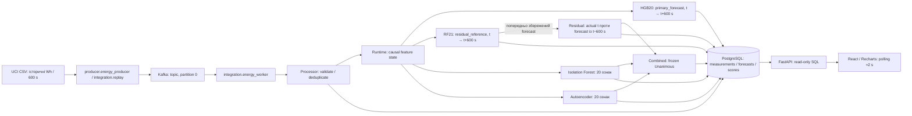
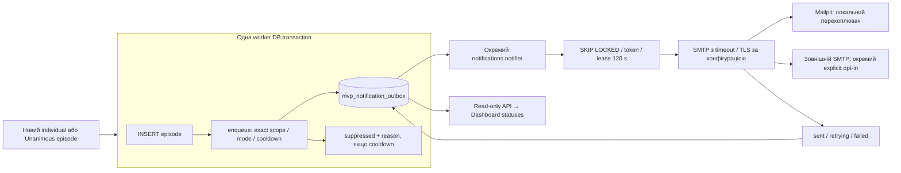

# Перевірена архітектура Energy Intelligence

Аудит коду бази `c156668a1bc41e20eb7c3c175eb5da1afd9037d7`, 27.10.2026.
Це опис реалізованого локального MVP, не проєкт майбутньої production-системи.
Функціональні докази: [CI evidence](ci-evidence.json), [матриця](traceability-matrix.md).

## 1. Основний потік



Стрілки ML→DB позначають дані, які Runtime повертає Processor/Repository, а не
самостійні writers або мережеві ML-сервіси. Усі ці моделі виконуються в одному
worker-процесі. FastAPI й Dashboard не навчають моделей і не запускають inference.

- Producer читає `producer/appliances_dataset.py`, зберігає історичні labels,
  створює стабільний `event_id`, керує темпом wall-clock replay.
- `integration/energy_worker.py` завантажує trusted manifest один раз, перевіряє
  group/topic ownership, broker/DB position, виконує `Processor.process`.
- `integration/processor.py` валідовує JSON/key, визначає duplicate/conflict,
  викликає Runtime і Repository у DB-транзакції.
- `processing/energy_processor.py`: спільні 20 causal features; `benchmark/features.py`:
  точний seasonal lag від **forecast target − 24 h**, загалом 21 ознака.
- `integration/runtime.py` адаптує Stage 2/4, не замінює HGB20 моделлю RF21.
- `storage/postgres/repository.py` зберігає записи, епізоди, receipts/checkpoint;
  `storage/postgres/combined.py` — окремі combined decisions/episodes.
- `api/main.py`, `api/query.py`, `api/schemas.py`: bounded SQL, фільтри, keyset cursors,
  агрегація енергії, response contracts. `dashboard/src/useMonitor.ts`, `data.ts`:
  обмежене вікно, backoff/abort, без паралельного нескінченного polling.
- `dashboard/src/insights.ts`: детерміновані правила видимого вікна, а не LLM,
  причинна діагностика обладнання чи новий навчений класифікатор.

Legacy IoT, Stage 2 Energy consumer і Stage 4 anomaly consumer залишаються окремими
сценаріями з CSV/Parquet. **Інтегрований MVP пише PostgreSQL; немає транзакційного
подвійного запису PostgreSQL+Parquet.** Старі offset/Parquet обмеження з
[recovery-and-delivery.md](../recovery-and-delivery.md) не слід приписувати новому
DB ledger або вважати автоматично усунутими в legacy consumers.

## 2. Transaction / recovery

```mermaid
sequenceDiagram
    participant K as Kafka partition 0
    participant W as Worker / Processor
    participant R as Runtime state
    participant D as PostgreSQL
    K->>W: offset, key, JSON
    W->>D: BEGIN; lock DB checkpoint
    W->>D: verify contiguous offset / receipt / event identity
    W->>R: compute тільки для нового валідного event
    R-->>W: forecasts, scores, statuses
    W->>D: measurement + 2 forecasts + 3 scores
    W->>D: episodes + combined + optional outbox
    W->>D: receipt + next_offset
    W->>D: COMMIT acknowledgement
    W->>K: explicit offset commit
    Note over W,D: Після збою — DB checkpoint є джерелом позиції
    W->>D: read останні ≤144 compatible records/source + pending forecasts
    W->>R: відновити історію; перевірити forecast parity
    Note over W,R: зберегти оригінальний generated_at; не переписувати forecasts
```

Kafka `enable_auto_commit=False`. Коміт offset можливий лише після повернення
`Processor.process`, тобто підтвердження DB commit. DB checkpoint/receipts та
Kafka retained journal звіряються; Kafka ahead, missing anchor, changed journal,
несумісний group/run/artifact context — помилка, а не silent earliest/latest reset.

Перед DB commit crash → rollback. In-memory state після exception позначається
poisoned: потрібен restart/recovery, не продовження з випередженою історією.
Після DB commit / до Kafka commit → повторне читання перевіряє receipt, не
перераховує збережені результати. Новий offset з тим самим event ID/content —
`message_duplicate`, інший content — conflict/quarantine. Гарантія ідемпотентності
діє у run/building/source та group/topic context, не між незалежними runs.

DB-resident open episodes відновлюються без відтворення колишніх notifications.
Worker бере advisory lock group/topic; checkpoint row lock відсікає stale processor.
Це локальна single-partition реалізація, не виміряний distributed autoscaling.

## 3. Episodes та Email



`notifications/outbox.py` викликається лише при INSERT епізоду. Немає SMTP або
HTTP усередині Kafka worker і немає retrospective scan старих епізодів.
`UNIQUE(kind, episode_id, recipient)` + existing event idempotency запобігають
дублюванню outbox. Cooldown використовує PostgreSQL wall-clock та scope
run/building/source/kind/method/recipient, не історичний dataset time.

Notifier: durable `sending` claim → row lock під час SMTP → delivery status.
Інший notifier пропускає locked row, прострочений claim після crash можна
перехопити; stale token не завершує доставку. До 5 спроб, bounded backoff для
тимчасових помилок; permanent errors завершуються `failed`. SMTP outage не
блокує worker, але недоступність спільної PostgreSQL впливає на обидва процеси.

`sent` — прийняття SMTP, не inbox/read receipt. Якщо SMTP прийняв лист, але DB
ack загублено, можливий повтор; exactly-once email не заявляється. Вимкнення,
зміна fingerprint, конфлікт режимів, restart queue описані в
[Stage 7C](../stage7c/email-notifications.md). Один адресу/точний scope на config.

## 4. Контракти й версії

| Контракт | Фактична семантика / код |
|---|---|
| Kafka JSON | `schemas/energy-message-v1.schema.json`, schema_version 1.0; key JSON `[building_id, source_id]` |
| Energy | interval energy, Wh; input kWh нормалізується у Wh; 600 s для чинних ML |
| Source binding | building/source/type/scope/interval/time semantics; довільного `scope=appliances` недостатньо |
| Measurement time | `measurement_timestamp`, dataset_naive або explicit offset; label не означає вигаданий UTC |
| Forecast | `forecast_origin=t`, `forecast_target_timestamp=t+600 s`, окремий UTC `generated_at` |
| Primary | HGB20, `purpose=primary_forecast`, `energy-features-v1` |
| Residual reference | RF21, `purpose=residual_reference`, `benchmark-energy-v1`; Stage 4 train-only refit, не Stage 3 final-fit weights |
| IF/AE | спільний порядок 20 ознак, `energy-anomaly-20-v1`, різні шкали scores |
| Thresholds | strict `score > threshold`; q99 у live; альтернативи q98/q99.5 збережені offline |
| Versions | artifact SHA+role → model_id; model_version / feature_version / threshold_version; registry immutable |
| Combined | окремий rule_version `combined-q99-v1-unanimous`, input_versions, coverage; не четвертий ML score |
| Null | warm-up/gap/incompatible залишають `null`; це не 0 і не `false` |

HGB20/IF/AE потребують 7 послідовних записів (6 початкових unready). RF прогноз
формується після 144; residual на наступній точці має 144 початкових unready.
Після gap історія переформовується; incompatible source зберігається з null
результатами й не змінює модельну історію. Combined не дає повний vote, поки
всі три scores не ready; available_trigger_count не підміняє trigger_count.

## 5. Storage і межі deployment

Три послідовні Alembic revisions: `0001_mvp` (10 таблиць), `0002_combined`
(+2), `0003_email` (+1). `schema.py` — metadata; DDL migrations заморожені окремо.
13 таблиць: models, runs, sources, measurements, forecasts, scores, episodes,
checkpoints, receipts, errors, combined_decisions, combined_episodes, notification_outbox.
Outbox episode_id — логічне поліморфне посилання, не SQL FK на дві таблиці.

`docker-compose.dashboard.yml`: private backend network, PostgreSQL/Kafka без
host ports; API loopback; nginx у network namespace API; тільки Web
`127.0.0.1:8088`. Це пояснює, чому proxy не обходить local-only middleware.
`docker-compose.email.yml`: opt-in profile; Mailpit Web `127.0.0.1:8025`, SMTP
без host port, persistent mailpitdata; notifier має network для дозволеного SMTP.
Host infrastructure compose публікує лише loopback 15432/19092; legacy 9092/8080
також loopback. Не слід запускати різні checkouts у одному project.

Credentials — локальні ignored `.env.*`, не response payload. Artifacts — trusted
pickle/joblib, монтуються read-only; SHA захищає цілісність, а не довіру до
довільного завантаженого pickle. Немає production auth/RBAC, HA, SLA чи гарантії
відновлення після довільного пошкодження DB/втрати Kafka retention.
